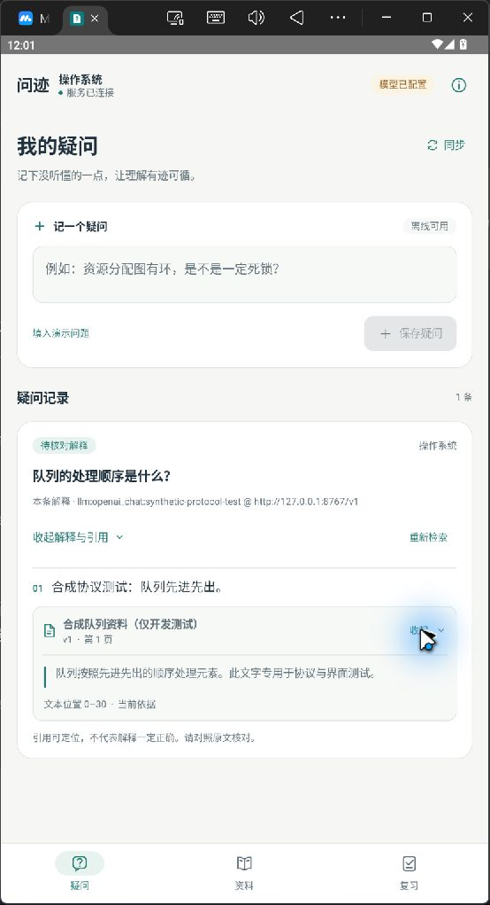
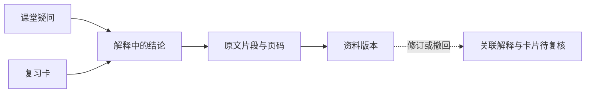
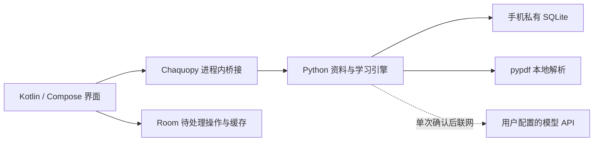

# 问迹

**把课堂上的一句“为什么”，连到有出处的解释和下一次独立作答。**

> 资源分配图有环，一定死锁吗？
>
> 答案里的关键条件，可能藏在讲义的某一句话里。等到几周后复习，依据还找得到吗？如果讲义改了，旧解释又该怎么办？

问迹是一款 **Android 课堂疑问溯源与复习助手**。从记下一条疑问开始，它把问题、资料原文、页码、版本和复习卡连起来：查到解释后先核对依据，复习时先自己回答；资料修订或撤回后，相关解释与卡片会进入待复核状态。

**本次版本：0.4.0 手机独立版开发预览** · Kotlin / Jetpack Compose · Chaquopy / Python / SQLite

[下载手机独立版](https://github.com/ChenYueqi2024/wenji/releases/tag/v0.4.0-preview) · [手机模型设置](MODEL_SETUP.txt) · [验证记录](docs/VALIDATION.md) · [AI 协作说明](docs/AI_DEVELOPMENT.md)

> 0.4 将资料处理、检索、引用核对和学习记录放进手机。日常使用无需电脑、Python 安装或 ADB 转发；默认固定案例可以离线完成。需要通用 AI 解释时，在应用内配置个人 API Key，由手机联网调用所选模型。

版本为 `v0.4.0-preview`，APK 文件名为 `wenji-0.4.0-preview.apk`。已通过 67 项 Python 测试、26 项 Android JVM 测试，以及移除电脑端口转发后的 4 项 MuMu 设备测试。手机端真实供应商调用、实体手机兼容性与新版界面视觉检查仍待验证，范围详见验证记录。

## 从一条疑问开始

| 你做的事 | 问迹接着做什么 |
| --- | --- |
| **课上记下来**：“有环就一定死锁吗？” | 在手机本地保存疑问，不需要联网或连接电脑。 |
| **把讲义放进来**：导入文字或可复制文本的 PDF | 在课程内检索候选片段，把引用连到原文、页码和资料版本。 |
| **沿着出处看解释** | 默认展示固定案例；启用模型后，每次生成前确认端点、模型和问题，再核对生成结果的引用。 |
| **合上解释，自己答一次** | 先独立作答，再查看参考关键点、自评并安排复习；不自动判题或标记“已掌握”。 |
| **讲义改版了** | 相关解释和复习卡进入待复核，提醒你重新检查依据。 |

每次查看解释，都能继续追问：**“答案来自哪里，依据现在还有效吗？”**

## 三步开始，不用连接电脑

1. **安装并打开问迹。** 从[发布页](https://github.com/ChenYueqi2024/wenji/releases/tag/v0.4.0-preview)下载 `wenji-0.4.0-preview.apk`，在手机上直接安装。支持 **Android 8.0（API 26）及以上的 64 位 arm64 / x86_64 设备**，不支持仅有 32 位运行环境的设备。首次体验可保持规则演示模式。
2. **导入内置教材。** 打开“资料”，点击“导入内置合成教材”。两页可复制文本 PDF 已包含在 APK 中，无需额外下载。也可通过系统文件选择器导入自己的文本 PDF 或 UTF-8 文本。
3. **从问题走到独立作答。** 记录“资源分配图有环，是否一定死锁？”，查找依据，核对原文、页码和版本；进入复习，先自己回答，再看参考关键点、自评并安排复习。

这三步可以离线完成。默认规则只覆盖这个合成案例；其他问题需要自行核对资料，或配置联网模型后生成解释。手机独立运行不代表安装包内包含通用大模型。

想继续体验资料变化：在原资料上执行修订，使用 [`resource_graph_v2.txt`](fixtures/resource_graph_v2.txt)，观察旧解释和旧卡进入待复核；另行导入一份资料不会修订原资料。撤回资料会清理手机中的相关正文和派生引用，保留个人历史作答并显示来源警示。

[`conflicting_material.txt`](fixtures/conflicting_material.txt) 和 [`insufficient_question.txt`](fixtures/insufficient_question.txt) 可用于合成冲突与资料不足场景。演示材料均为开发编写，不是真实课堂采样。

### 从 0.3 升级时，资料在哪里？

0.4 使用新的手机学习空间，不自动迁移电脑数据库、旧手机缓存或旧待发送请求。原资料仍保留在电脑，旧 Room 数据也不主动删除。需要的资料可重新导入手机；旧学习记录目前没有自动迁移入口。手机模型设置同样需要重新填写，不会从电脑复制密钥。

## 看看界面

### 生成前确认，生成后查原文

以下是 **0.3.0 电脑版服务架构下的历史截图**，来自 MuMu，展示单次请求确认与引用展开。使用合成教学材料和本机模拟响应，界面中的“非真实模型”标签保留；这些图片既不是外部真实模型回答的截图，也不是 0.4 手机独立运行的验收证据。

 

[查看历史横屏确认弹窗](docs/images/model-consent-wide.png)。这轮历史检查中，取消没有调用模拟服务，确认后调用一次，再次生成需要重新确认。

### 疑问、资料、复习，围绕同一条线索

以下为 **0.2.0 的历史界面截图**，同样来自 MuMu 实际运行，内容为合成教学材料；用于展示三页工作流，不代表新版本全流程验收。


  

## 答案如何留下可追溯的线索



- **引用能回到原文。** 手机内置引擎检查模型返回的结构、引用归属、原文位置与资料版本。引用定位正确，仍不等于结论已获语义证明；阅读者需要核对。
- **资料变化会传到旧答案。** 保存生成结果前再次检查问题、资料和配置，过期结果会被丢弃。模型用过的上下文变化时，整条解释和复习卡会保守地进入待复核。
- **缺资料时可以停下来。** 没有词项候选就不发起模型请求。模型返回“资料不足”或“存在冲突”时，不生成正常自测卡；通用语义判断能力仍待评测。
- **重试有明确边界。** 同一已发送请求 ID 不会重复调用模型。刷新与应用重启不会自动重发待处理的解释请求；先查看最新状态，必要时停止旧重试，再重新查找依据并确认。新请求可能再次计费。

### 模型接入：可选，且由你确认

在“手机模型设置”中填写协议、API 基址、模型名称、个人 API Key 和最大输出 Token，提供四种文本生成协议适配器：

| 配置协议 | 接口类型 |
| --- | --- |
| `openai_chat` | OpenAI Chat Completions 兼容接口 |
| `openai_responses` | Responses |
| `anthropic_messages` | Anthropic Messages |
| `gemini_generate_content` | Gemini generateContent |

保存设置不会发出模型请求。每次生成前仍需核对地址、模型和本次问题，再单独确认。密钥使用 Android Keystore 支持的 AES/GCM 加密，保存在应用私有存储；安装包不包含个人真实密钥。重新打开设置不会回填密钥；同一 API 基址可留空沿用已保存密钥，更换地址必须重新输入。

服务需要兼容所选协议；专有签名、特殊请求或响应格式需要新增适配器，并非任意 API 地址都能直接使用。手机设置提供常用参数；多档案、额外请求头和其他兼容开关仍属于可选的电脑开发配置，详见 [MODEL_SETUP.txt](MODEL_SETUP.txt)。

**历史联调范围：电脑服务的两次真实模型请求。** 2026-11-17，0.3 电脑服务对一个 Chat Completions 兼容端点测试了两条合成教学用例：有依据时返回带引用解释；缺少实验统计时返回“资料不足”，未生成正常复习卡。同请求重放未重复调用，来源修订后结果进入待复核。这不是 0.4 手机端的真实模型验证，也不代表全部供应商兼容或通用回答质量达标。其他协议为本机模拟验证，详情见 [验证记录](docs/VALIDATION.md)。

## 手机里运行了什么



APK 内包含 Python 3.12 运行时、经过筛选的业务模块和 pypdf。界面直接调用进程内引擎，不启动手机 HTTP 服务；电脑服务和 `127.0.0.1:8765` 不参与手机日常使用。两个 64 位 ABI 及运行库会增加安装包体积，具体大小以发布资产为准。[Chaquopy 官方构建说明](https://chaquo.com/chaquopy/doc/current/android.html)介绍了 Python 与 ABI 的打包方式。

## 从源码构建与检查

以下仅供开发者；安装 APK 的用户不需要安装这些工具。构建需要 **JDK 17、Android SDK 35、Build Tools 35.0.0、Python 3.12**。Gradle 8.11.1 由 wrapper 获取，Chaquopy 17.2.0 负责打包 Python；首次构建需联网下载 Gradle、Android 依赖、Python 运行时与 pypdf。

用 Android Studio 打开 `android/` 并配置 JDK 与 SDK；或在已设置 `JAVA_HOME` 和 `ANDROID_HOME` 的 PowerShell 中执行。若 Python 3.12 不在 PATH，可通过 `WENJI_BUILD_PYTHON` 指向其可执行文件：

```powershell
$env:WENJI_BUILD_PYTHON = 'C:\Python312\python.exe' # 换成自己的 Python 3.12 路径
.\android\build-local.ps1 -Tasks assembleDebug,lintDebug,testDebugUnitTest
```

APK 输出到 `android/app/build/outputs/apk/debug/app-debug.apk`。后端检查可运行：

```powershell
.\scripts\test.ps1
```

目前通过 **67 项 Python 测试，其中 11 项覆盖手机进程内桥接**：离线 PDF 与学习流程、模型确认、配置切换、无效配置拒绝、进程中断保留请求等。测试使用临时数据库和合成凭证；桥接测试禁止 socket，协议测试使用临时回环模拟服务。它们不构成手机安装、Android Keystore、实际网络或真实模型调用的验收结果。

HTTP smoke 同样使用临时回环服务，不改动演示数据库；日志写入被 Git 忽略的本地 `reports/`。若运行环境阻止回环连接，应在允许 localhost 的本机终端复验。0.4 已构建并通过 26 项 JVM 和 4 项 MuMu 设备测试；包括失败恢复、Lint 提示和未完成范围的记录见 [VALIDATION.md](docs/VALIDATION.md)。当前为开发预览，不包含正式发行签名或应用商店发布材料。

### 可选：保留的电脑开发服务

共享领域引擎仍可通过电脑上的 HTTP 服务进行开发和协议调试。此路径使用独立的电脑数据库，不连接或同步手机数据库，也不是运行 0.4 APK 的前提。以下命令从仓库根目录执行：

```powershell
python -m venv .venv
.\.venv\Scripts\python.exe -m pip install -r requirements.txt
$env:WENJI_PYTHON = (Resolve-Path .\.venv\Scripts\python.exe).Path
.\scripts\run_service.ps1
```

服务只监听 `127.0.0.1:8765`，使用 `data/wenji.sqlite3`。如需调试高级模型配置，可参考 [models.example.json](config/models.example.json) 与 [MODEL_SETUP.txt](MODEL_SETUP.txt) 的电脑开发章节，运行 `run_model_service.ps1`。这些 JSON 档案和环境变量不会自动进入手机。

### 目录导航

```text
android/       Kotlin / Compose、手机模型设置、Room、Chaquopy 打包与测试
server/        共享 Python 领域引擎、手机进程内桥接、可选电脑 HTTP 服务
tests/         Python 领域、手机桥接与模型协议回归测试
fixtures/      合成教学文本与可复制文本 PDF
scripts/       开发服务启动、自动化检查与设备辅助脚本
config/        无密钥电脑模型配置示例
docs/          验证记录、界面变更与 AI 协作说明
```

## 数据与当前边界

手机 SQLite 保存资料、解释、引用和学习记录，Room 保存待处理操作与最近缓存。启用外部模型时，只发送本次问题和词项检索命中的最多 **8 个片段、合计 12000 字符**；原 PDF 文件与个人学习记录不随该生成请求上传，但片段可能含敏感内容，使用前需确认资料授权和服务商。撤回资料会清理手机中的相关文本，不能撤回服务商已收到的内容。

目前面向单门课程、单设备，没有账户认证、课程成员权限或云端同步，`course_id` 与配置指纹不是权限凭据。手机本地功能无需网络，远程 AI 仍需可用网络、兼容端点和个人密钥。OCR、语音、后台复习通知尚未实现；PDF 限 5 MB、100 页以内的未加密可复制文本。尚无真实学生试用、学习成效或性能结论。

## AI 协作与许可

随 APK 附带的运行库声明见 [第三方组件说明](android/app/src/main/assets/notices/NOTICES.txt)，相邻目录保留对应许可原文。

代码与文档由 Codex 辅助开发，实际分工和限制见 [AI 协作说明](docs/AI_DEVELOPMENT.md)。协作摘要不代表任何人已独立完成、审查或理解全部实现。

本项目 **尚未指定开源许可证**；公开源码不等同于授予复制、修改或再分发许可。第三方组件适用各自许可：[Chaquopy 为 MIT](https://github.com/chaquo/chaquopy/blob/master/LICENSE.txt)，[pypdf 为 BSD-3-Clause](https://github.com/py-pdf/pypdf/blob/main/LICENSE)；Python 运行时、Android 依赖和 Gradle wrapper 也须保留各自要求的许可声明。第三方许可不替代本项目许可。本仓库不包含个人报名、签字或身份材料。
