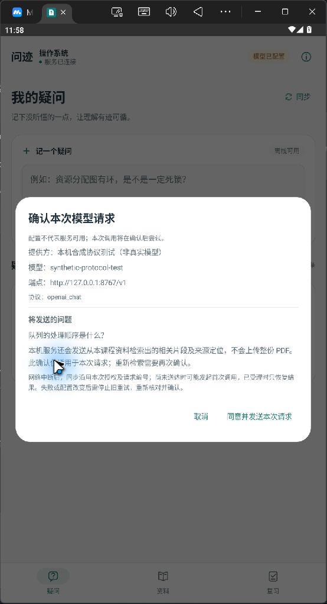
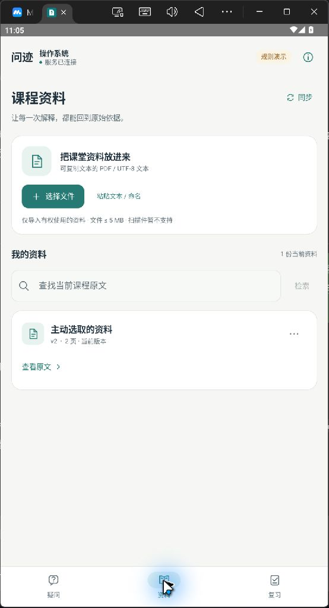
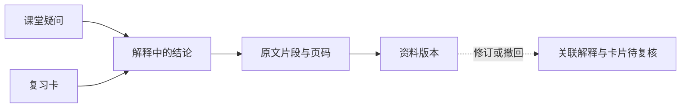

# 问迹

**把课堂上的一句“为什么”，连到有出处的解释和下一次独立作答。**

> 资源分配图有环，一定死锁吗？
>
> 答案里的关键条件，可能藏在讲义的某一句话里。等到几周后复习，依据还找得到吗？如果讲义改了，旧解释又该怎么办？

问迹是一款 **Android 课堂疑问溯源与复习助手**。从记下一条疑问开始，它把问题、资料原文、页码、版本和复习卡连起来：查到解释后先核对依据，复习时先自己回答；资料修订或撤回后，相关解释与卡片会进入待复核状态。

**当前版本：0.3.1 开发预览** · Kotlin / Jetpack Compose · Python / SQLite

[下载预览 APK](https://github.com/ChenYueqi2024/wenji/releases/tag/v0.3.1-preview) · [模型接入说明](MODEL_SETUP.txt) · [验证记录](docs/VALIDATION.md) · [AI 协作说明](docs/AI_DEVELOPMENT.md)

> 当前面向单门课程、单设备、本机服务。APK 需要电脑上的 Python 服务和 ADB 端口转发；只安装 APK 不能体验完整功能。默认提供无需模型密钥的固定合成案例演示。

## 从一条疑问开始

| 你做的事 | 问迹接着做什么 |
| --- | --- |
| **课上记下来**：“有环就一定死锁吗？” | 在设备上保存疑问；离线也能记录，联网后再同步。 |
| **把讲义放进来**：导入文字或可复制文本的 PDF | 在课程内检索候选片段，把引用连到原文、页码和资料版本。 |
| **沿着出处看解释** | 默认展示固定案例；启用模型后，每次生成前确认端点、模型和问题，再核对生成结果的引用。 |
| **合上解释，自己答一次** | 先独立作答，再查看参考关键点、自评并安排复习；不自动判题或标记“已掌握”。 |
| **讲义改版了** | 相关解释和复习卡进入待复核，提醒你重新检查依据。 |

每次查看解释，都能继续追问：**“答案来自哪里，依据现在还有效吗？”**

## 看看界面

### 生成前确认，生成后查原文

以下是 **0.3.0 在 MuMu 中的实际运行截图**，展示单次请求确认与引用展开。使用合成教学材料和本机模拟响应，界面中的“非真实模型”标签保留；这些图片不是外部真实模型回答的截图。

 

[查看横屏确认弹窗](docs/images/model-consent-wide.png)。这轮检查中，取消没有调用模拟服务，确认后调用一次，再次生成需要重新确认。

### 疑问、资料、复习，围绕同一条线索

以下为 **0.2.0 的历史界面截图**，同样来自 MuMu 实际运行，内容为合成教学材料；用于展示三页工作流，不代表新版本全流程验收。


  

## 答案如何留下可追溯的线索



- **引用能回到原文。** 服务端检查模型返回的结构、引用归属、原文位置与资料版本。引用定位正确，仍不等于结论已获语义证明；阅读者需要核对。
- **资料变化会传到旧答案。** 生成期间允许资料更新；保存结果前再次检查问题、资料和配置，过期结果会被丢弃。模型用过的上下文变化时，整条解释和复习卡会保守地进入待复核。
- **缺资料时可以停下来。** 没有词项候选就不发起模型请求。模型返回“资料不足”或“存在冲突”时，不生成正常自测卡；通用语义判断能力仍待评测。
- **重试有明确边界。** 同一已发送请求 ID 不会重复调用模型；超时或中断后先同步核对，再主动发起新的生成。0.3.1 中，待同步请求返回服务端错误后仍会尝试刷新最新来源状态，并保留失败请求。

### 模型接入：可选，且由你确认

支持配置 API 根地址、模型名和密钥环境变量，提供四种文本生成协议适配器：

| 配置协议 | 接口类型 |
| --- | --- |
| `openai_chat` | OpenAI Chat Completions 兼容接口 |
| `openai_responses` | Responses |
| `anthropic_messages` | Anthropic Messages |
| `gemini_generate_content` | Gemini generateContent |

服务需要兼容所选协议；专有签名、特殊请求或响应格式需要新增适配器，并非任意 API 地址都能直接使用。配置示例见 [models.example.json](config/models.example.json)，兼容参数和重试方法见 [MODEL_SETUP.txt](MODEL_SETUP.txt)。

**真实模型小范围联调已完成。** 2026-11-17，对一个 Chat Completions 兼容端点测试了两条合成教学用例：资源分配图问题返回带引用的解释；资料未提供实验统计时返回“资料不足”，没有编造统计或生成正常复习卡。同请求重放未重复调用，来源修订后解释与卡片进入待复核。这是该配置下的小范围行为验证；其余协议仍为本机模拟验证，不代表所有供应商兼容或通用回答质量达标。详情见 [验证记录](docs/VALIDATION.md)。

## 在电脑与 Android 上跑起来

### 1. 启动本机服务

需要 **Python 3.11+**、Android SDK Platform Tools，并让 `adb` 可在终端调用。以下 PowerShell 命令从仓库根目录执行：

```powershell
python -m venv .venv
.\.venv\Scripts\python.exe -m pip install -r requirements.txt
$env:WENJI_PYTHON = (Resolve-Path .\.venv\Scripts\python.exe).Path
.\scripts\run_service.ps1
```

服务监听 `http://127.0.0.1:8765`，数据保存在本地 `data/wenji.sqlite3`，按 Ctrl+C 停止。也可在相同 Python 环境中运行 `python -m server --db data/wenji.sqlite3 --port 8765`。不要在同一端口重复启动服务。

默认模式使用固定合成案例规则。若要启用模型，先停止旧服务，将 `config/models.example.json` 复制为 `config/models.local.json`，选择档案并填写协议、API 根地址和模型名，然后运行：

```powershell
.\scripts\run_model_service.ps1
```

脚本会在需要时隐藏输入 API Key，并临时传给服务进程。密钥不要写入 Android、JSON 或 Git。修改配置后需重启服务并在 Android 同步；配置错误不会静默切回演示。完整步骤见 [模型接入说明](MODEL_SETUP.txt)。

### 2. 安装预览 APK 并连接服务

从 [v0.3.1-preview 发布页](https://github.com/ChenYueqi2024/wenji/releases/tag/v0.3.1-preview) 下载 `wenji-0.3.1-preview.apk`。发布页附 APK SHA256；最低系统为 **Android 8.0（API 26）**。

在另一个终端中查看已授权的设备，将下面的设备编号和 APK 路径换成实际值：

```powershell
adb devices
adb -s <设备编号> install -r <APK路径>
adb -s <设备编号> reverse tcp:8765 tcp:8765
```

然后打开问迹并同步。当前验证环境为 MuMu Android 12；实体手机安装、软键盘和不同输入法体验仍待验证。这是调试 APK，不含正式发行签名配置或应用商店发布材料。

### 3. 走一遍“有环是否死锁”

1. 在资料页粘贴 [`fixtures/resource_graph_v1.txt`](fixtures/resource_graph_v1.txt)，或通过系统文件选择器导入 `resource_graph_v1.pdf`。
2. 记录“资源分配图有环，是否一定死锁？”，保存并同步，再查找依据，核对引用页码与版本。
3. 进入复习，先独立输入答案，再查看参考关键点、自评并安排复习。
4. **在原资料上执行修订**，使用 [`resource_graph_v2.txt`](fixtures/resource_graph_v2.txt)，观察旧解释与旧卡进入待复核。另行导入一份资料不会修订原资料。
5. 撤回资料，检查来源警示。服务会清除相关正文及派生引用；历史个人作答仍保留，离线设备需同步后才能获知变更。

[`conflicting_material.txt`](fixtures/conflicting_material.txt) 和 [`insufficient_question.txt`](fixtures/insufficient_question.txt) 可用于合成冲突与资料不足场景。所有演示材料均为开发编写，不是真实课堂采样。

## 从源码构建与检查

Android 构建需要 **JDK 17、Android SDK 35、Build Tools 35.0.0**；Gradle 8.11.1 由 wrapper 获取，首次构建需要联网下载依赖。

用 Android Studio 打开 `android/` 并配置 JDK 与 SDK；或在已设置 `JAVA_HOME` 和 `ANDROID_HOME` 的 PowerShell 中执行：

```powershell
.\android\build-local.ps1 -Tasks assembleDebug,lintDebug,testDebugUnitTest
```

APK 输出到 `android/app/build/outputs/apk/debug/app-debug.apk`。后端检查可运行：

```powershell
.\scripts\test.ps1
```

Python 测试使用内存或临时数据库，HTTP smoke 启动临时回环服务，不改动演示数据库；原始日志写入被 Git 忽略的本地 `reports/`。若运行环境阻止回环连接，应在允许 localhost 的本机终端复验。各版本通过的构建、自动化检查和视觉检查范围见 [VALIDATION.md](docs/VALIDATION.md)。

### MuMu 辅助脚本

完成源码构建和 Python 依赖安装后，启动 MuMu 实例并确认其 ADB 调试端口。`16384` 只是脚本默认值，请按实例配置调整。在另一终端执行：

```powershell
$env:WENJI_PYTHON = (Resolve-Path .\.venv\Scripts\python.exe).Path
.\scripts\connect_mumu.ps1 -AdbPort 16384
```

脚本连接实例、安装当前构建的调试 APK、建立端口转发，将合成 PDF 放入 `Download/Wenji` 并启动应用。若 8765 端口没有现成服务，会在后台启动固定案例服务，使用 `data/mumu-demo.sqlite3`；进程 ID 与日志写入 `reports/mumu/`，演示后可按该 ID 停止服务。要使用模型，应先启动上面的模型服务。

也可用已有服务手动安装并复制材料：

```powershell
.\android\install-debug.ps1 -DeviceId '127.0.0.1:16384' -IncludeFixtures
```

### 目录导航

```text
android/       Kotlin / Compose 客户端、Room schema、Gradle wrapper 与 JVM 测试
server/        Python 本机服务、资料依赖关系、规则解释器与模型适配器
tests/         Python 领域回归测试
fixtures/      合成教学文本与可复制文本 PDF
scripts/       服务启动、自动化检查与 MuMu 连接脚本
config/        无密钥模型配置示例
docs/          验证记录、界面变更与 AI 协作说明
```

## 数据与当前边界

Android 使用 Room 保存疑问、待同步请求和最近缓存，电脑服务使用 SQLite。启用外部模型时，只发送本次问题和词项检索命中的最多 **8 个片段、合计 12000 字符**；原 PDF 文件与个人学习记录不随该生成请求上传，但片段可能含敏感内容，使用前需确认资料授权和服务商。撤回资料会清理本机相关文本，不能撤回服务商已收到的内容。

目前没有账户认证、课程成员权限或云端同步，`course_id` 与配置指纹不是权限凭据。服务只监听 `127.0.0.1`，请保持本机使用；离线缓存可能过期，来源状态以同步后为准。OCR、语音、后台复习通知尚未实现，也尚无真实学生试用、学习成效或性能结论。

## AI 协作与许可

代码与文档由 Codex 辅助开发，实际分工和限制见 [AI 协作说明](docs/AI_DEVELOPMENT.md)。协作摘要不代表任何人已独立完成、审查或理解全部实现。

本项目 **尚未指定开源许可证**；公开源码不等同于授予复制、修改或再分发许可。第三方依赖及 Gradle wrapper 适用各自许可。本仓库不包含个人报名、签字或身份材料。
