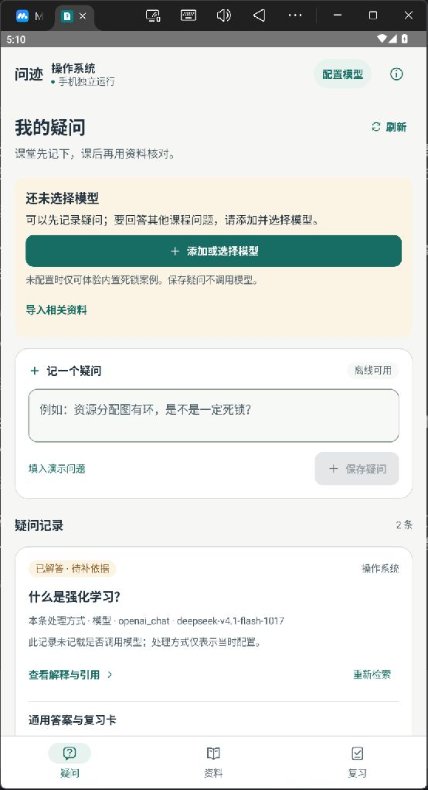
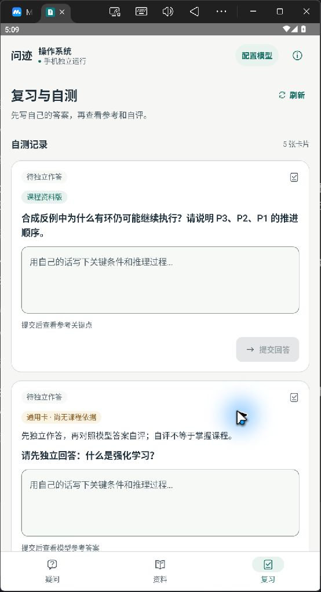
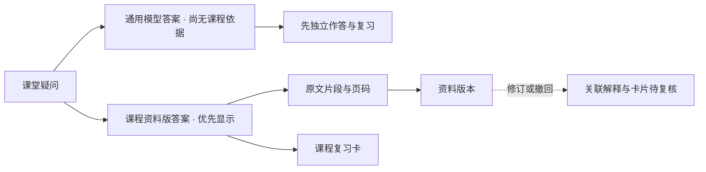
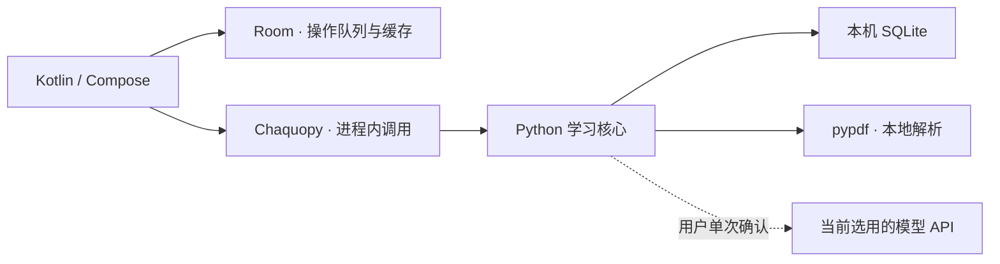

# 问迹

**课堂上先留下一个“为什么”，课后再把答案接回原文。**

> “资源分配图有环，一定死锁吗？”
>
> 先记下。讲义还没拿到，也可以让模型解释、自己答一次。
> 等资料导入，再核对那句关键条件，把有依据的答案放到前面。
> 如果讲义改了，旧答案也应该提醒你重新检查。

问迹是一款 **Android 课堂疑问溯源与复习助手**。它把记录疑问、模型解释、课程引用和独立作答连成一条学习路径。手机可以独立运行；资料处理和学习记录留在本机，需要生成模型答案时才联网。

**当前版本：v0.5.1-preview** · Android 8.0+ · Kotlin / Compose · Python / SQLite

[下载 APK](https://github.com/ChenYueqi2024/wenji/releases/download/v0.5.1-preview/wenji-0.5.1-preview.apk) · [发布说明](https://github.com/ChenYueqi2024/wenji/releases/tag/v0.5.1-preview) · [模型配置](MODEL_SETUP.txt) · [验证记录](docs/VALIDATION.md)

## 从“没听懂”到“说得清”

| 学习中的一刻 | 问迹帮你接上下一步 |
| --- | --- |
| **课上来不及问** | 写一句疑问，离线保存，不用先整理完整笔记。 |
| **课后还没有讲义** | 单独确认后，仅把问题发给所选模型，生成通用答案和复习卡，标注“尚无课程依据”。 |
| **拿到课程资料了** | 导入文字或可复制文本 PDF，再确认生成引用版答案。有效的课程资料版优先显示，原通用答案和作答历史保留。 |
| **觉得自己看懂了** | 先独立作答，再看参考内容、自评并记录复习。模型不会替你宣布“已掌握”。 |
| **讲义换了版本** | 依赖旧资料的解释与卡片进入待复核，提醒你回到新依据。 |

**先有一个可学习的答案，再让它拥有可核对的出处。** 两种答案始终标明来源；通用模型回答不会被包装成课程原文证明。

## 两种方式开始

1. **安装。** 从[发布页](https://github.com/ChenYueqi2024/wenji/releases/tag/v0.5.1-preview)下载 `wenji-0.5.1-preview.apk`。支持 Android 8.0（API 26）及以上、64 位 arm64-v8a / x86_64 运行环境；不需要电脑服务、Python 安装或 ADB 转发。已有 0.4.x / 0.5.x 可覆盖安装，保留本地数据请勿先卸载。
2. **选一种体验。** 想离线试用，在“资料”页导入内置的两页合成教材，再记录“资源分配图有环，是否一定死锁？”。想回答自己的问题，点击首页“添加或选择模型”，配置一个供应商和模型。
3. **开始一次学习。** 有资料就查找课程依据；没资料就确认生成通用答案与复习卡。进入“复习”，先写下自己的理解，再查看参考内容。

离线规则只解答内置的资源分配图案例。通用 AI 需要兼容的服务、个人 API Key 和网络，APK 内没有内置通用大模型。

想体验依据失效：在原资料上执行修订，使用 [`resource_graph_v2.txt`](fixtures/resource_graph_v2.txt)，观察旧解释和卡片进入待复核。另行导入一份资料不会自动修订原资料。所有内置教材均为合成材料，不是真实课堂采样。

## 你的供应商，你的模型

首页入口直接打开 **供应商与模型**。管理方式很简单：

**添加供应商 → 添加模型 → 使用此模型**

- 每个供应商独立保存地址、API 格式和一个加密 Key，可添加多个模型及各自输出上限。同一服务的不同 Key 可以分别建立供应商条目。
- 最多保存 20 个供应商、每个 40 个模型。保存新配置不会自动启用；由你明确选择下一次生成所用的模型。
- 暂停模型、切回离线会保留配置。删除当前模型或供应商后回到离线，不自动改用另一家服务。
- 保存与切换不会发送模型请求。每次生成前，都会再次确认实际端点、模型、问题及发送范围。
- 模型名和可识别的第三方别名可以显示官方上下文、输出上限与图像能力参考。它不是当前部署的能力探测，也不会擅自改写模型名或参数；问迹当前只发送文本。

| API 格式 | 对应接口 |
| --- | --- |
| `openai_chat` | Chat Completions 兼容接口 |
| `openai_responses` | Responses |
| `anthropic_messages` | Anthropic Messages |
| `gemini_generate_content` | Gemini generateContent |

兼容的是这些协议结构。专有签名、特殊参数或响应格式仍可能需要适配；尚无批量配置文件导入、自动发现远端模型或密钥轮换池。完整说明见 [MODEL_SETUP.txt](MODEL_SETUP.txt)。

Key 使用 Android Keystore 支持的 AES/GCM 加密，保存在应用私有空间；安装包不包含个人密钥。编辑时不回填已保存的 Key，更换供应商地址须重新输入。旧单一配置提供本地迁移；迁移测试范围和一次实际设备配置为空的核查结果见[验证记录](docs/VALIDATION.md#配置迁移与实际设备观察)。

## 看看它现在的样子

以下是 **v0.5.1 在 MuMu 中的实际运行截图**。首页突出模型入口，复习页区分课程资料卡和无依据通用卡。截图时处于离线模式，显示了保留的历史内容；本次截图检查没有调用真实模型。

 

正文增至 16sp、次要文字 14sp，提示颜色加深；小屏页头分行，横屏设置内容可滚动。实际检查发现大字体会挤压资料页按钮，v0.5.1 已改为按空间上下排列：[查看 320dp、1.3 倍字体的修复效果](docs/images/standalone-v051-large-text-actions.png)。更多过程见[界面改进记录](docs/UI_CHANGES.md)。

## 每个答案都有自己的证据状态



- **引用能回到原文。** 引擎检查引用归属、文本位置、页码与版本。定位正确仍不等于语义正确，需要对照原文核对。
- **无依据的答案不冒充有依据。** 通用卡有明确标识，不据此自动改变课程疑问的掌握状态。资料导入只在本地保存；随后确认生成资料版，成功后优先显示并保留旧答案、卡片和作答。
- **不足与冲突有出口。** 课程检索没有候选时不联网；资料不足或冲突时保留缺项，不强造课程引用。用户仍可另行确认通用参考。
- **旧依据不能悄悄延用。** 来源变化沿依赖关系传播，保存结果前再次检查问题、资料和配置。两版答案还没有自动语义一致性判断。
- **重试不会悄悄重发。** 同一已发送请求 ID 不再次调用模型；刷新和重启不自动重发。结果不确定时先核对记录，新生成需要再次确认，也可能再次计费。

## 手机里运行了什么



APK 包含 Python 3.12、经过筛选的业务模块和 pypdf，不启动手机 HTTP 服务。电脑上的 `127.0.0.1:8765` 服务保留作开发调试，日常手机使用不依赖它，两个数据域也不会自动同步。

课程引用请求发送问题和检索命中的最多 8 个片段、合计 12000 字符；通用参考只发送问题。不会随生成请求上传整份 PDF 或学习记录。片段仍可能含敏感内容，发送前请核对。撤回本地资料不能撤回服务商已经收到的内容。

## 已经验证到哪一步

| 范围 | 真实记录 |
| --- | --- |
| v0.5.1 构建与 JVM | 构建成功，43 项测试通过；Lint 0 错误、11 项提示。 |
| v0.5.1 MuMu | 13 项隔离设备测试通过，覆盖学习流程、传输约束和 7 项多供应商存储场景。没有 ADB 反向转发。 |
| 界面复验 | 指定页面的横竖屏、约 320dp 窄屏及 1.3 倍字体检查；发现并修复按钮挤压。不是全机型或完整无障碍验收。 |
| Python 基线 | v0.4.2 全量 88 项通过；v0.5.x 没有重跑全部 Python 测试，设备回归再次执行内嵌核心流程。 |
| 真实模型 | v0.4.2 在 MuMu 中确认调用一次“什么是强化学习？”，通用参考保存并显示；补卡使用本地历史文本，没有第二次调用。v0.5.x 未新增真实调用。 |

测试数量不代表回答准确率或学习效果。实体手机、不同输入法、软键盘遮挡、完整首启流程与学习成效仍需专项验证。试用方报告本人和 8 名同学使用手机体验，整体流畅但有小问题；没有提供完整任务记录或量化数据，不据此推出完成率、耗时或效果结论。详见[验证记录](docs/VALIDATION.md)。

## 从源码构建

开发环境需要 **JDK 17、Android SDK 35、Build Tools 35.0.0、Python 3.12**。先设置 `JAVA_HOME` 指向 JDK、`ANDROID_HOME` 指向 SDK，或用 Android Studio 配置项目；下面的 PowerShell 命令从仓库根目录执行。Gradle 8.11.1 使用 wrapper，Chaquopy 17.2.0 打包运行时，首次构建需下载依赖。安装 APK 的用户不需要这些工具。

```powershell
$env:WENJI_BUILD_PYTHON = 'C:\Python312\python.exe' # 改成自己的 Python 3.12 路径
.\android\build-local.ps1 -Tasks assembleDebug,assembleDebugAndroidTest,testDebugUnitTest,lintDebug
```

APK 输出到 `android/app/build/outputs/apk/debug/app-debug.apk`。共享 Python 核心检查使用单独环境，并以 `WENJI_PYTHON` 指定测试解释器：

```powershell
& $env:WENJI_BUILD_PYTHON -m venv .venv
.\.venv\Scripts\python.exe -m pip install -r requirements.txt
$env:WENJI_PYTHON = (Resolve-Path .\.venv\Scripts\python.exe).Path
.\scripts\test.ps1
```

HTTP 测试使用临时回环服务，需要本机 localhost 可用；测试结果不能代替实际供应商联通检查。可选电脑服务及高级配置见 [MODEL_SETUP.txt](MODEL_SETUP.txt)。

```text
android/    Compose 界面、Room、Keystore、Chaquopy 与 Android 测试
server/     共享学习核心、手机桥接、可选电脑 HTTP 服务
tests/      Python 领域与协议回归
fixtures/   合成教学材料
config/     无密钥模型配置示例
docs/       分版本验证、界面变化与 AI 协作说明
```

## 当前边界与协作

配套的 V1.7 匿名材料：[项目计划书 PDF](https://github.com/ChenYueqi2024/wenji/releases/download/v0.5.1-preview/wenji-project-plan-v1.7.pdf) · [运行与演示说明 PDF](https://github.com/ChenYueqi2024/wenji/releases/download/v0.5.1-preview/wenji-run-guide-v1.7.pdf)。这些是作品说明材料，不代表报名或参赛提交已完成；本人办理的资格与签字文件不进入公开发布。

这是**开发预览调试包**，不是应用商店正式发行版。当前面向单门课程、单设备；没有账户认证、课程成员权限或云同步。只支持文字及未加密的可复制文本 PDF（5 MB、100 页限制），OCR、语音、多模态输入、后台复习通知和跨设备导出接续尚未实现。

代码与文档由 Codex 辅助开发，[AI 协作说明](docs/AI_DEVELOPMENT.md)如实记录工作与限制，不替代维护者理解实现，也不构成个人独立贡献证明。公开仓库不含个人报名、签字或身份材料。

项目尚未指定开源许可证。公开源码不等于授予复制、修改或再分发许可；第三方运行库适用各自许可证，见[组件与许可说明](android/app/src/main/assets/notices/NOTICES.txt)。
