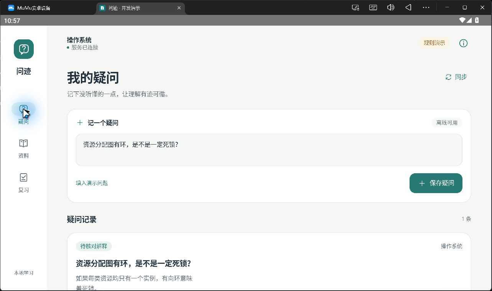
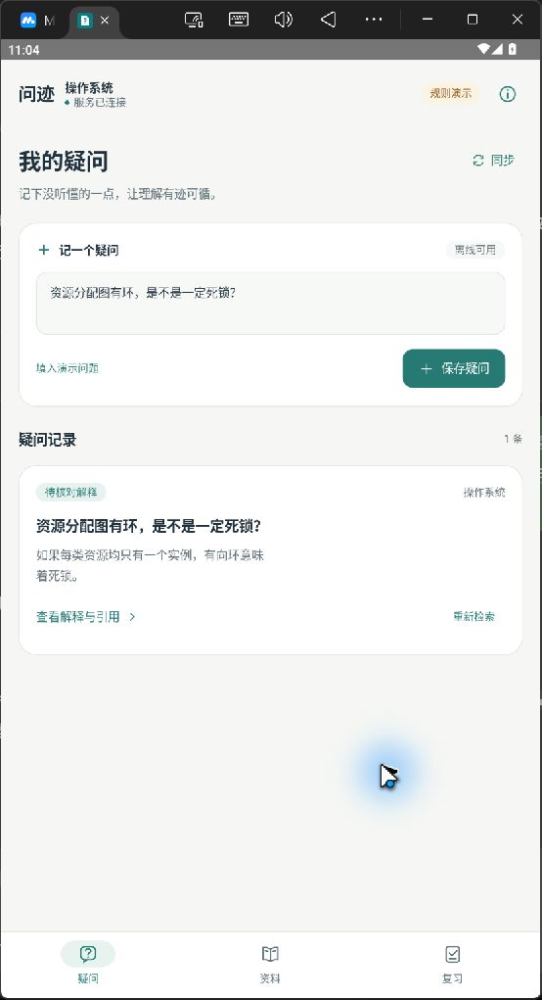
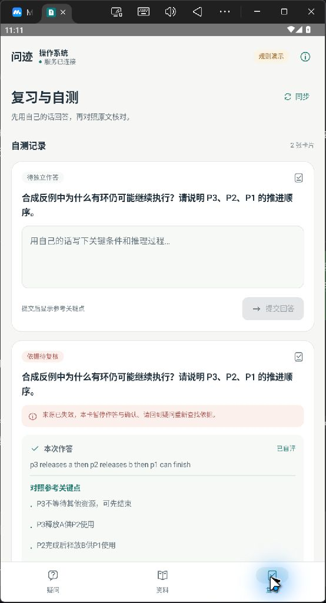

# 问迹

**0.2.0 开发预览** · Android 课堂疑问溯源与复习助手

把课堂疑问与课程资料中的原文、页码和版本连起来。先记录问题，再核对依据、独立作答和自评；资料修订或撤回后，相关解释与复习卡进入待复核状态。

这是单门课程、单设备、本机服务的可运行开发预览，不是生产产品。当前解释由**固定合成案例的确定性提取规则**生成，未接入真实大模型，未实现账户认证。普通资料可以进行词项检索，匹配结果不代表语义支持或置信度。

## 运行界面

以下为 MuMu Android 12 的实际运行截图，使用合成教学材料。



  

界面变更见 [0.2 更新说明](docs/UI_CHANGES.md)，实际通过范围见 [验证记录](docs/VALIDATION.md)。

## 当前功能与边界

- Kotlin / Jetpack Compose Android 客户端，Room 保存疑问、待同步请求和最近缓存；离线可记录疑问、查看已缓存内容。
- 本机 Python / SQLite 服务支持文字和可复制文本 PDF 导入、课程内词项检索、页码与版本引用、资料修订及撤回。
- 合成“资源分配图有环是否一定死锁”案例可以体验解释、自测、参考关键点及用户自评。不自动打分，也不自动标记“已掌握”。
- 证据不足时保留待补资料状态；合成冲突案例并列呈现依据。通用语义冲突识别未实现。
- 写请求使用请求 ID 重试，资料版本冲突拒绝覆盖；无网络时缓存可能过期，需要同步确认最新来源状态。

尚未实现真实模型、账户与课程成员权限、云端同步、OCR、语音、后台复习通知。`course_id` 只是数据分区，不是权限凭据。服务只监听 `127.0.0.1`，请勿改为公网服务。此版本不包含真实学生调研、学习成效或性能结论。

## 目录

```text
android/       原生客户端、Gradle wrapper、Room schema 与 JVM 测试
server/        本地 HTTP 服务、数据依赖关系与固定案例解释器
tests/         Python 领域回归测试
fixtures/      合成教学文本与可复制文本 PDF
scripts/       本地启动、测试和 MuMu 连接脚本
docs/          AI 协作说明、导出清单及后续发布验证记录
```

## 环境与服务启动

需要 Python 3.11+；Android 构建使用 JDK 17、Android SDK 35、Build Tools 35.0.0。Gradle 8.11.1 由 wrapper 获取。安装 Android SDK Platform Tools，并让 `adb` 可在终端调用。首次构建需要联网下载依赖。

以下 PowerShell 命令从仓库根目录执行：

```powershell
python -m venv .venv
.\.venv\Scripts\python.exe -m pip install -r requirements.txt
$env:WENJI_PYTHON = (Resolve-Path .\.venv\Scripts\python.exe).Path
.\scripts\run_service.ps1
```

服务使用 `http://127.0.0.1:8765`，数据保存在本地 `data/wenji.sqlite3`；按 Ctrl+C 停止。也可直接运行 `python -m server --db data/wenji.sqlite3 --port 8765`。不要在同一端口重复启动服务。

## 构建 Android 调试包

使用 Android Studio 打开 `android/`，选择 JDK 17 并配置 SDK；或在已设置 `JAVA_HOME` 和 `ANDROID_HOME` 的 PowerShell 中执行：

```powershell
.\android\build-local.ps1 -Tasks assembleDebug,lintDebug,testDebugUnitTest
```

生成的 APK 位于 `android/app/build/outputs/apk/debug/app-debug.apk`。最低系统为 Android 8.0（API 26）。这是调试构建，不含正式发行签名配置或应用商店发布材料。

## 在本机 MuMu 运行

启动 MuMu Android 实例，开启其 ADB 调试能力，并在 MuMu 配置中确认本地 ADB 端口。该端口可能随实例变化；以下 `16384` 仅是脚本默认值。先完成上面的 Android 构建和 Python 依赖安装。

在另一终端中设置同一虚拟环境并运行：

```powershell
$env:WENJI_PYTHON = (Resolve-Path .\.venv\Scripts\python.exe).Path
.\scripts\connect_mumu.ps1 -AdbPort 16384
```

脚本连接所选实例、安装调试 APK、建立 `adb reverse tcp:8765 tcp:8765`，把合成 PDF 复制到 `Download/Wenji` 并启动应用。如 8765 端口没有现成服务，它会启动后台本机服务，使用 `data/mumu-demo.sqlite3`，进程 ID 与日志写入被 Git 忽略的 `reports/mumu/`。结束演示后可按该进程 ID 停止这个本地服务。

也可手动执行（把设备编号替换为 `adb devices` 中已授权的目标）：

```powershell
adb devices
.\android\install-debug.ps1 -DeviceId '127.0.0.1:16384' -IncludeFixtures
```

实体手机也可使用已授权的 USB 调试连接和同一安装脚本。模拟器验证不能替代实体手机兼容性验证。MuMu 的自动化粘贴曾把快捷键注入为不可见控制字符，服务端已增加拒绝校验；这不表示所有输入法兼容性均已验证。

## 体验合成案例

1. 在资料页通过系统文件选择器导入 `Download/Wenji/resource_graph_v1.pdf`，或粘贴 `fixtures/resource_graph_v1.txt`。
2. 记录“资源分配图有环，是否一定死锁？”，保存并同步，然后查找依据，核对引用页码与版本。
3. 进入复习并先独立输入答案，再查看参考关键点、自评安排复习。
4. 在原资料上执行修订，使用 `resource_graph_v2.txt`；旧解释与旧卡应进入待复核。另行导入新资料不会修订原资料。
5. 撤回资料时，服务清除其正文及派生引用；历史个人作答仍保留并显示来源警示。离线设备需同步才能获知变更。

`conflicting_material.txt` 和 `insufficient_question.txt` 用于合成冲突与资料不足场景。这些材料为开发演示编写，不是真实课堂采样。

## 运行检查

```powershell
.\scripts\test.ps1
.\android\build-local.ps1 -Tasks lintDebug,testDebugUnitTest
```

Python 测试使用内存或临时数据库；HTTP smoke 自行启动临时回环服务，不改动演示数据库。原始运行日志写入本地 `reports/`，不会随源码提交。若受管理沙箱阻止回环连接，应在允许 localhost 的本机终端复验，并记录环境失败。

已完成的检查及仍待验证的范围见 [版本验证记录](docs/VALIDATION.md)，其中分别记录源码构建、软件测试和模拟器视觉检查，不将构建成功等同于完整产品验收。

## AI 协作与许可

代码及文档有 Codex 辅助开发，范围与限制见 [AI 协作说明](docs/AI_DEVELOPMENT.md)。协作摘要不代表任何人已独立完成、审查或理解全部实现。

本项目**尚未指定开源许可证**；公开源码不等同于授予复制、修改或再分发许可。第三方依赖及 Gradle wrapper 适用各自许可。本仓库不包含个人报名、签字或身份材料。
