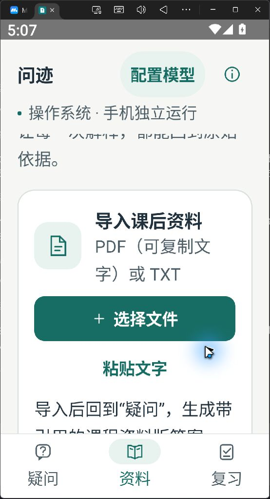

# 界面改进 · v0.5.1-preview

当前重点是让第一次打开应用的人能迅速看清：现在能做什么，下一步点哪里。以下改动沿用 Kotlin / Compose，没有加入虚构的学习天数、掌握率或用户成绩。

## 模型接入成为清楚的一条路径

首页同时提供全宽模型入口和页头“配置模型 / 切换模型”。未配置时说明离线案例能做什么、为什么自己的问题需要模型服务；首次提示可以选择配置，也可以先离线体验。

供应商管理按照 **添加供应商 → 添加模型 → 使用此模型** 组织。宽屏为供应商侧栏与详情，窄屏从列表进入详情。当前选用使用文字标明，不以“已保存”冒充“已连通”。新增配置不自动启用，暂停转离线保留目录和密钥。

管理页仅固定标题、完成按钮及必要错误反馈，其余信息可滚动，避免短横屏被说明占满。Key 不回填；未保存的 Key 只存在界面内存，管理及编辑窗口启用 `SecureOn`。具体保护行为与实际测试范围见 [VALIDATION.md](VALIDATION.md)。

## 字能看清，操作不拥挤

- 正文 16sp、次要文字 14sp、标签至少 13sp，增加行高；次要文字加深到 `#4D5D66`。
- 提示框同时使用文字、边界和颜色区分状态，不让浅色成为唯一线索。
- 关键按钮最小高度 48dp；窄屏页头分为两行，课程和运行状态不挤在按钮之间。
- 首次引导、导入说明和发送确认拆成短段落，保留无课程依据、发送范围、来源变更及自评非掌握等关键信息。
- 0.5.1 根据实际大字体检查增加自适应操作区：可用宽度不足时全宽上下排列，空间足够时恢复横排。覆盖资料导入/修订、疑问保存/解释操作及复习提交/自评。

指定颜色组合的静态 sRGB 对比计算为：次要文字/背景 6.35:1、绿色提示 5.50:1、黄色提示 6.01:1、红色提示 5.81:1。这不是整机无障碍验收，也不能代替实际字号与布局检查。

## 实际发现的一次问题

在约 320dp 竖屏、1.3 倍字体条件下，“选择文件”和“粘贴文字”并排时，后者被挤成两行。0.5.1 改为上下排列后，以相同条件复验，按钮文字完整可读。

图中顶部和底部只显示当前滚动视口，属于长页面滚动范围；它不是整页静态原型。本次还检查了默认显示的首页、复习卡层级，以及横屏表单滚动、空表单错误和取消。旧 0.5.0 配置页组件在 0.5.1 中未变，其检查结果仍按原时点记录。

实际用户目录当时为空，因此没有以真实 Key 重复完整的已配置供应商/模型编辑与切换 GUI 流程。首启全新安装、软键盘、不同输入法、实体手机与完整无障碍检查仍未覆盖。数据行为测试和界面检查分别记录。

## 保留的早期设计

0.2 起使用米白背景、白色卡片、墨蓝正文和青绿色主操作，宽屏侧边导航、窄屏底部导航。疑问、资料、复习三个页面分别突出快速记录、原文导入和独立作答；全文、历史回答与详细说明按需展开。

后续版本持续保留来源不足、冲突、失效和操作失败的明确提示。0.4.1 修正了横屏表单错误被藏在滚动底部的问题；0.4.2 增加通用答案、无依据复习卡与资料版优先显示，0.5.x 再完成多供应商和可读性改进。旧截图不改标为新版本。
